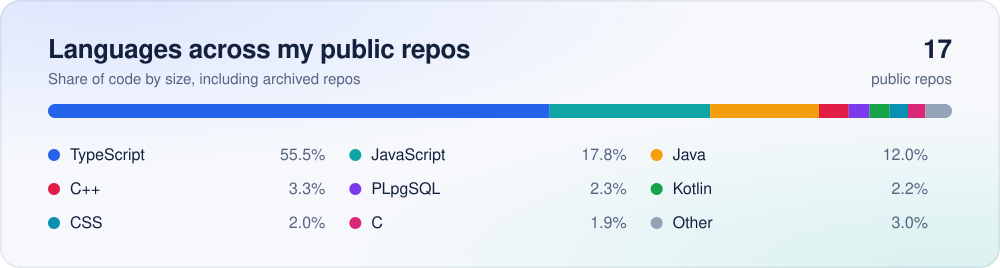

<picture>
  <source media="(prefers-color-scheme: dark)" srcset="assets/banner-dark.svg">
  
</picture>

## 🚀 About Me

I'm a CS graduate from NJIT's Ying Wu College of Computing (May 2026) and an online MBA student at Montclair State University. I interned as a software development engineer on the Amazon Dedicated Cloud BlackMirror team at AWS. There I built a lossless compression algorithm for metric exports. It reduced export payloads by an average of 38 GB per day, and by up to 60 GB per day, across 3 air-gapped regions.

I like working close to infrastructure. I care about how systems move data, where the bottlenecks are, and how to monitor them. I'm also drawn to the coordination side of technical work, which is why I'm studying project management alongside my CS background. I speak English and Spanish.

## 🎯 What I'm Looking For

**Primary:** Technical Project Management, Project Management, IT roles, and Bank Technology Analyst programs.

**Also open to:** cloud roles (Solutions Architecture, Cloud Support) and software engineering.

Based in New Jersey, open to roles across the NYC metro area.

<picture>
  <source media="(prefers-color-scheme: dark)" srcset="assets/divider-dark.svg">
  
</picture>

## 📌 Featured Projects

**[LinkdUp](https://github.com/iaalcantara17/LinkdUp)** ([live at linkdup.app](https://linkdup.app)) 
A group meetup planner. Everyone shares a location, the group swipes on nearby spots around the midpoint, votes on a place, and locks in a date that can go straight to Google Calendar. Swiping is locked-step, so everyone votes on the same card before the deck moves on. It was a five-person NJIT CS/IT 491 capstone that placed 2nd, and I was the backend engineer. Built with TypeScript, Expo and React Native Web, an Express API on Render, Supabase, and the web app on Vercel.

**[PortfolioV2](https://github.com/iaalcantara17/PortfolioV2)** ([live at israelalcantara.vercel.app](https://israelalcantara.vercel.app)) 
The source for my portfolio site, built with React 19, Vite, and GSAP. It has two Vercel serverless functions and 34 Playwright smoke tests that run in Chromium, Firefox, and WebKit in both light and dark mode.

**[SFort95 Interpreter](https://github.com/iaalcantara17/SFort95-Interpreter)** 
A lexer, a recursive-descent parser, and an interpreter in C++ for SFort95, a Fortran 95-style teaching language from NJIT's CS280. The interpreter runs each statement as it parses it and reports type and variable errors by line. The [lexer](https://github.com/iaalcantara17/Lexical-Analyzer-for-SFort95-Language) and [parser](https://github.com/iaalcantara17/Parser-for-SFort95-Language) repos are the earlier stages.

More projects are pinned above.

<picture>
  <source media="(prefers-color-scheme: dark)" srcset="assets/divider-dark.svg">
  
</picture>

## 🎓 Education and Coursework

**Montclair State University, Feliciano School of Business** 
Online MBA (in progress)
- Fall 2026 coursework: Global Economy (ECON 565), Business Statistics (INFO 561, with R and Excel), Strategic Information Systems (INFO 565), Business Essentials (MGMT 560)
- Planned electives: Project Management, Agile Project Management, Advanced Project Management, Complex Project and Program Management

**New Jersey Institute of Technology, Ying Wu College of Computing** 
B.S. Computer Science, cum laude (May 2026)
- Coursework: Advanced Data Structures and Algorithms, Database System Design and Management, Principles of Operating Systems, Introduction to Computer Networks, Introduction to Machine Learning, Introduction to Cybersecurity, Designing the User Experience, Design in Software Engineering, Programming Language Concepts, Information Design Techniques, Introduction to Computer Science I and II (Java), Intensive Programming in Linux (Bash, C, Python, MongoDB, PHP, BeautifulSoup), Senior Capstone (LinkdUp)

**Also:** CodePath Android Development with Kotlin ([FlixterPlus](https://github.com/iaalcantara17/FlixterPlus), [Wishlist](https://github.com/iaalcantara17/Wishlist), [codepath-wordle](https://github.com/iaalcantara17/codepath-wordle))

## 🛠️ Technical Depth

**Languages:** Java, Python, TypeScript, JavaScript, C++, C, Bash, SQL, Kotlin

**Cloud and infrastructure:** AWS, Linux, Supabase, Render, Vercel, Git

**Frameworks and tools:** React, React Native, Node.js, Express, Pandas, scikit-learn, MySQL, MongoDB

<picture>
  <source media="(prefers-color-scheme: dark)" srcset="assets/divider-dark.svg">
  
</picture>

## 📊 GitHub Activity

<picture>
  <source media="(prefers-color-scheme: dark)" srcset="assets/stats-dark.svg">
  
</picture>

<picture>
  <source media="(prefers-color-scheme: dark)" srcset="https://raw.githubusercontent.com/iaalcantara17/iaalcantara17/output/github-snake-dark.svg">
  
</picture>

## 🌐 Connect

[LinkedIn](https://www.linkedin.com/in/israel-alcantara/) · [Portfolio](https://israelalcantara.vercel.app) · [Email](mailto:ialcantara2003@gmail.com) · [Buy Me a Coffee](https://buymeacoffee.com/iaalcantara17)

## ⚡ Outside the Terminal

Basketball, photography (Canon Rebel SL3), piano, drawing, music, hiking.

